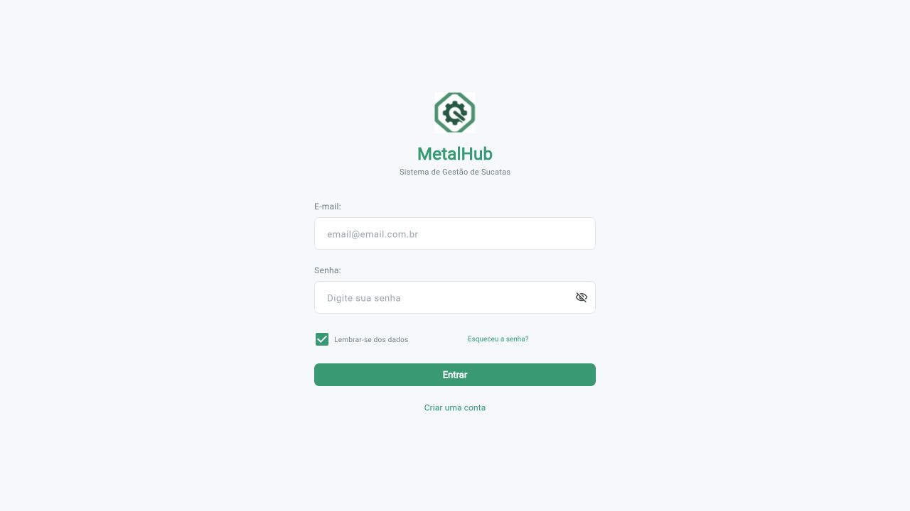
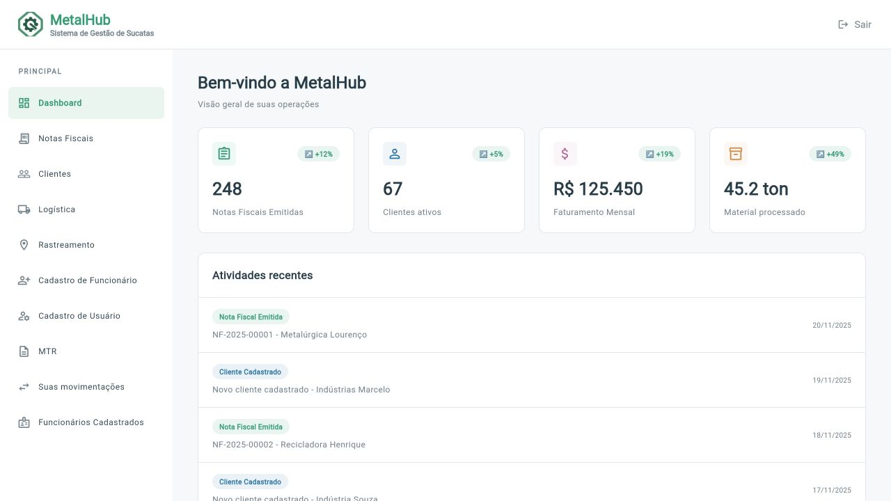
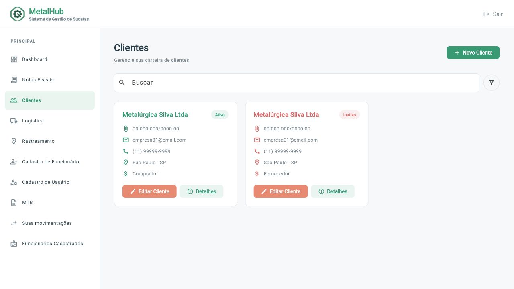
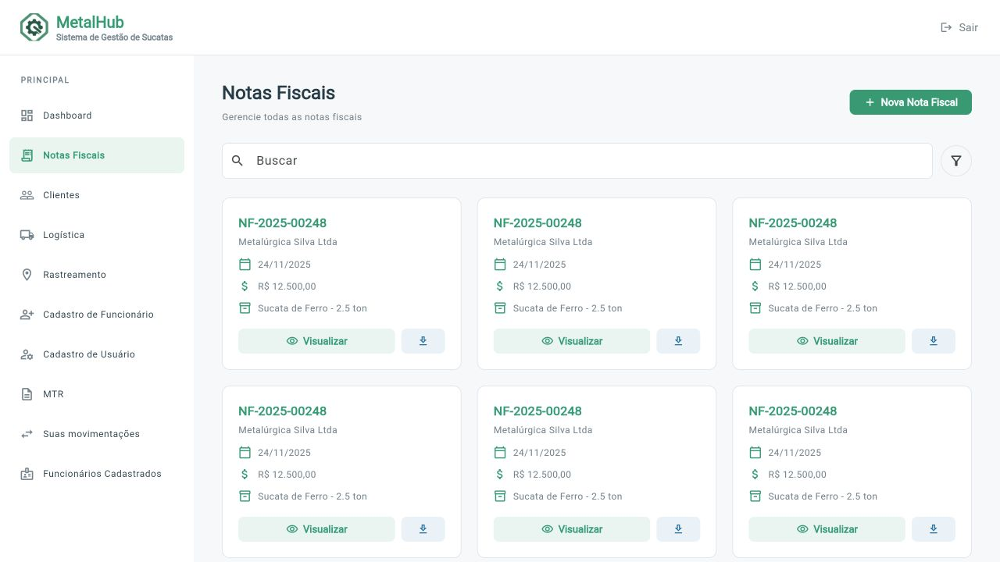
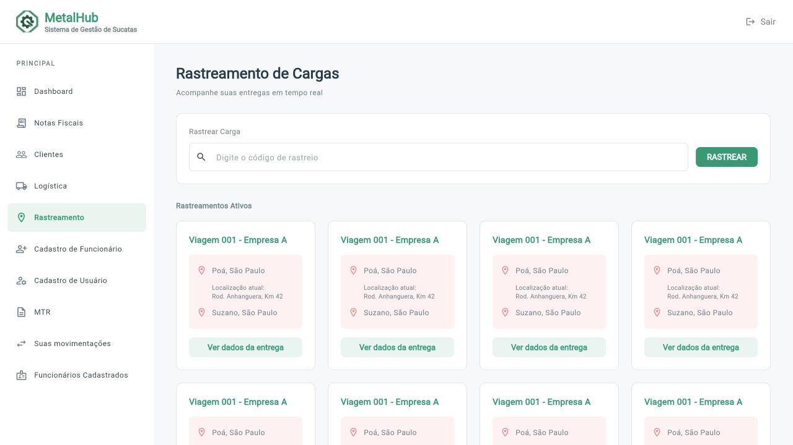
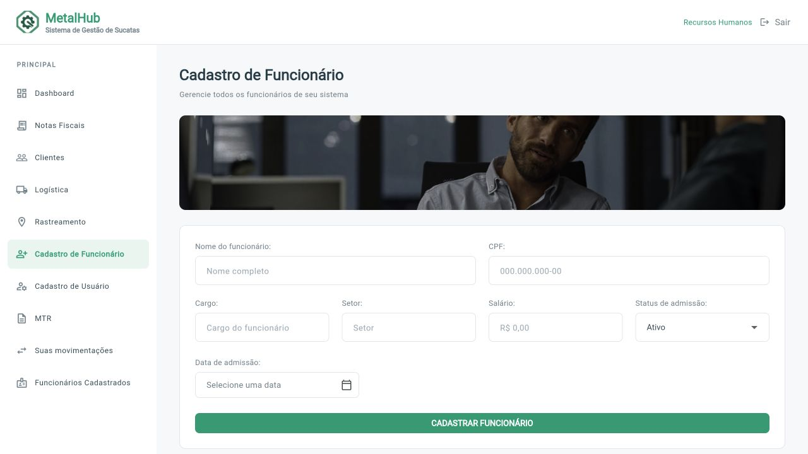

# MetalHub

Sistema de gestão de sucatas para organizar clientes, funcionários, notas fiscais e transporte de materiais em uma única aplicação. Disponível para Android, iOS e web.

<p align="center">
  
</p>

[Visão geral](#visão-geral) · [Telas](#telas) · [Tecnologias](#tecnologias) · [Como executar](#como-executar) · [Acesso](#acesso-ao-sistema) · [Equipe](#equipe)

## Visão geral

O MetalHub reúne as informações usadas no dia a dia de uma operação de sucatas. O Dashboard apresenta indicadores e atividades recentes; os demais módulos concentram os cadastros, documentos e entregas.

O projeto contém 14 telas, com navegação adaptada para celular, tablet e navegador. A barra lateral aparece em janelas maiores e é substituída por um menu retrátil em telas menores.

### Recursos disponíveis

- Dashboard com indicadores e histórico de atividades.
- Consulta de clientes, funcionários, notas fiscais, entregas e manifestos de transporte.
- Busca local nas listagens, com tratamento de acentos e mensagem para resultados vazios.
- Formulários de clientes PF/PJ, funcionários e usuários.
- Seleção de data de admissão e alternância entre pessoa física e jurídica.
- Interface em português, com componentes e identidade visual compartilhados.

### Estado das integrações

As listagens usam dados de exemplo mantidos no código. Os cadastros de clientes PF/PJ salvam e recuperam os dados em JSON no armazenamento local do aplicativo, inclusive após reiniciar. Os demais formulários ainda não persistem registros. O login aceita o usuário `admin` e a senha `admin`, preenchidos inicialmente e verificados no próprio aplicativo. Não há autenticação por servidor.

Autenticação por servidor, banco de dados remoto, emissão de NF/MTR, download de documentos e localização em tempo real estão pendentes. Os botões dessas operações informam que a funcionalidade não está disponível.

## Telas

Capturas da aplicação Flutter executada no navegador.

| Login | Dashboard |
| --- | --- |
|  |  |

| Clientes | Notas fiscais |
| --- | --- |
|  |  |

| Rastreamento | Cadastro de funcionário |
| --- | --- |
|  |  |

## Tecnologias

| Tecnologia | Uso |
| --- | --- |
| Dart | Linguagem da aplicação, com null safety |
| Flutter | Interface e execução em Android, iOS e web |
| Material 3 | Componentes visuais e tema |
| Flutter Localizations | Textos e calendário em português |
| Flutter Test | Testes de widgets, navegação e busca |
| Flutter Lints | Análise estática |
| GitHub Actions | Análise e testes a cada push ou pull request |

## Acesso ao sistema

Na tela de login, utilize:

| Campo | Valor |
| --- | --- |
| Usuário | `admin` |
| Senha | `admin` |

Os campos já vêm preenchidos. Clique em **Entrar** para acessar o sistema. Se alterar os campos, informe novamente **admin / admin**.

## Como executar

### Requisitos

- Flutter **3.47.7 stable**, com Dart **3.13.5**. Essa é a versão usada na validação e no workflow de CI.
- Android Studio com os plugins Flutter e Dart para desenvolvimento Android.
- Chrome para executar a versão web.
- macOS com Xcode para compilar e executar no iOS.

Confira a configuração do ambiente:

```sh
flutter doctor
```

Baixe o repositório ou faça o clone pelo endereço informado no botão **Code** do GitHub. Na raiz do projeto, onde está o arquivo `pubspec.yaml`, execute:

```sh
flutter pub get
flutter devices
flutter run
```

No Android Studio, abra essa mesma pasta, escolha o dispositivo e execute `lib/main.dart`.

**Acesso:** usuário `admin` e senha `admin`. Os campos de login já vêm preenchidos.

### Web

```sh
flutter run -d chrome
```

### Android

Inicie um emulador ou conecte um aparelho com depuração USB habilitada. Em seguida, execute `flutter run` e selecione o dispositivo.

### iOS

Inicie um simulador de iPhone e selecione-o no Android Studio ou na lista de `flutter devices`. Também é possível abrir `ios/Runner.xcworkspace` no Xcode e executar o esquema **Runner**.

Para um iPhone físico, configure a equipe de assinatura em **Signing & Capabilities** no Xcode. Se houver falha de instalação a partir de um disco externo, use uma cópia do projeto no disco interno do Mac.

## Verificação

```sh
flutter analyze
flutter test
```

A suíte verifica cadastro e edição de clientes, recuperação do JSON, duplicidade de documentos, erros de armazenamento, o fluxo de login, a busca com e sem resultados e o layout das 14 telas em larguras de 360, 768, 1920 e 3840 pixels. O workflow [Flutter](.github/workflows/flutter.yml) executa a análise e os testes no GitHub.

## Compilação

| Destino | Comando | Saída |
| --- | --- | --- |
| Android | `flutter build apk --release --split-per-abi` | `build/app/outputs/flutter-apk/` |
| Web | `flutter build web --release` | `build/web/` |
| Simulador iOS | `flutter build ios --simulator --debug` | `build/ios/iphonesimulator/Runner.app` |

Os APKs são separados por arquitetura. O arquivo `app-arm64-v8a-release.apk` atende aparelhos Android ARM64. A configuração de assinatura Android atual usa a chave de desenvolvimento; a publicação em loja exige uma chave de distribuição própria.

Para conferir a saída web localmente, execute `python3 -m http.server 8080 --directory build/web` e acesse `http://localhost:8080`. A versão web precisa ser servida por HTTP.

## Organização

```text
lib/
├── app.dart          # Rotas e configuração do aplicativo
├── main.dart         # Ponto de entrada
├── core/             # Tema, cores e navegação
├── data/             # Persistência local dos clientes em JSON
├── models/           # Modelo de cliente
├── screens/          # Telas e estado dos formulários
└── widgets/          # Componentes compartilhados e layout responsivo
assets/images/        # Marca e banners
android/              # Configuração Android
ios/                  # Configuração iOS
web/                  # Inicialização web
test/                 # Testes automatizados
docs/                 # Capturas e documentação
```

O estado de formulários, filtros e menu é local aos widgets. O cadastro de clientes usa o modelo em `lib/models/client.dart` e o repositório em `lib/data/client_repository.dart`, com JSON persistido por `shared_preferences`. Não há comunicação com serviços externos nem sincronização entre dispositivos. Veja [Arquitetura](docs/ARQUITETURA.md) para os detalhes da estrutura atual.

## Equipe

- Luiz Nicolau Junior
- Matheus Souza dos Santos
- Rubens Barros Ferraz
- Samuel Epaminondas Costa
- Yuri Maurino Borges

Para trabalhar no repositório, consulte [Contribuição](CONTRIBUTING.md). As instruções de envio e os itens restantes da entrega estão em [Publicação no GitHub](docs/GITHUB.md) e [Entrega](docs/ENTREGA.md).
